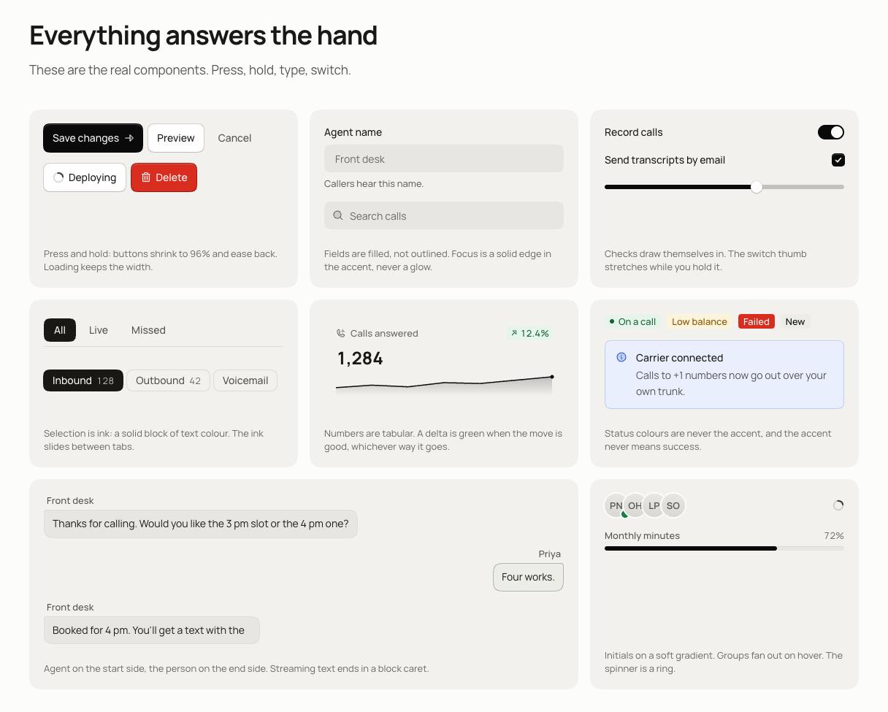
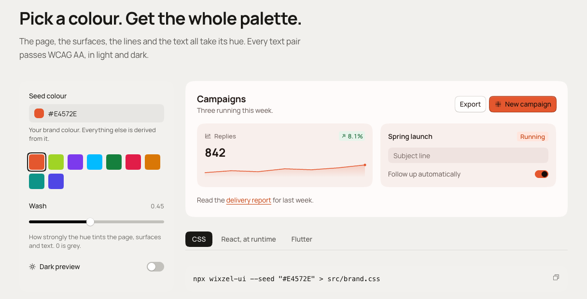

# Wixzel UI

The design system behind every Wixzel product, open for anyone to use.

Calm screens and crafted components: tinted paper and ink, panels drawn as tonal
fills instead of bordered boxes, squircle corners, and controls that answer the
hand (presses shrink, checks draw themselves, menus sharpen out of a blur). Set
**one seed colour** and the whole palette follows, in light and dark, with every
text pair passing WCAG AA.

**Docs, live components and a theme builder: [ui.wixzel.com](https://ui.wixzel.com)**

[](https://ui.wixzel.com/components/)

Every component, live, with its code: [ui.wixzel.com/components](https://ui.wixzel.com/components/)

| Package | What it is | Install |
|---|---|---|
| [`wixzel-ui`](packages/react) | React 19 + Tailwind v4 components on Radix, the tokens (CSS variables, Tailwind theme, JSON) and the seed CLI | `npm i wixzel-ui` |
| [`wixzel_ui`](packages/flutter) | Flutter theme and `Wx*` widgets | `flutter pub add wixzel_ui` |

## Convert a project with Claude

The [`wixzel-ui` skill](skills/wixzel-ui/SKILL.md) teaches Claude the design
language, the components and the steps to convert an existing React, Next.js,
Vue, Svelte, HTML or Flutter project: survey first, keep every logo and every
word, swap components screen by screen, then check both themes.

**Claude Code**

```
/plugin marketplace add wixzel/wixzel-ui
/plugin install wixzel-ui@wixzel
```

**Claude app:** download [`wixzel-ui-skill.zip`](https://ui.wixzel.com/wixzel-ui-skill.zip)
(also attached to every [release](https://github.com/wixzel/wixzel-ui/releases))
and upload it under Settings › Capabilities › Skills.

**Any agent that reads skills:** unzip it into your skills folder.

```bash
curl -LO https://ui.wixzel.com/wixzel-ui-skill.zip
unzip wixzel-ui-skill.zip -d ~/.claude/skills
```

Then, in your project: *"Convert this project to Wixzel UI. Our brand colour is #E4572E."*

## Your colour

[](https://ui.wixzel.com/#theme)

Web:

```bash
npx wixzel-ui --seed "#E4572E" > src/brand.css
```

```css
@import "tailwindcss";
@import "wixzel-ui/styles.css";
@import "./brand.css";
```

Flutter:

```dart
final brand = wxDeriveProduct(const Color(0xFFE4572E));

MaterialApp(
  theme: WixzelTheme.custom(tokens: brand).toThemeData(),
  darkTheme: WixzelTheme.custom(tokens: brand, brightness: Brightness.dark).toThemeData(),
);
```

Both derive the palette the same way in OKLCH, so a seed gives the same hex
values on the web and on mobile. The Flutter tests check it against every
built-in product.

## Using Wixzel UI outside Wixzel

The code is MIT. The Wixzel name and logo are not part of that licence. On your
own product, leave out the parts that sign for Wixzel: `SiteFooter` (it carries
"© Wixzel"), `ProductSwitcher`, and the `brandProducts` / `socials` data. Build
your footer from `SiteContainer`, `FooterColumn` and `FooterLink`, and put your
own logo in `SiteHeader`.

## Developing

Node 22.18+ and pnpm 10.

```bash
pnpm install
pnpm build          # tokens, then the React package
pnpm check          # contrast of every text pair, and types
pnpm site           # ui.wixzel.com on localhost:3010
pnpm skill          # dist/wixzel-ui-skill.zip
cd packages/flutter && flutter test
```

Tokens live in [`packages/tokens/src/tokens.ts`](packages/tokens/src/tokens.ts), a workspace package that `wixzel-ui` bundles.
The build writes the CSS, the Tailwind theme, the JSON and the Dart file from it;
`pnpm check` fails if any text pair drops below WCAG AA or the Dart file is out of
date. The design rules are in [PHILOSOPHY.md](PHILOSOPHY.md).

Issues and pull requests are welcome. A new component should follow the design
language and come with its details written down, the way PHILOSOPHY.md does for
the existing ones.

## License

[MIT](LICENSE) © Wixzel
