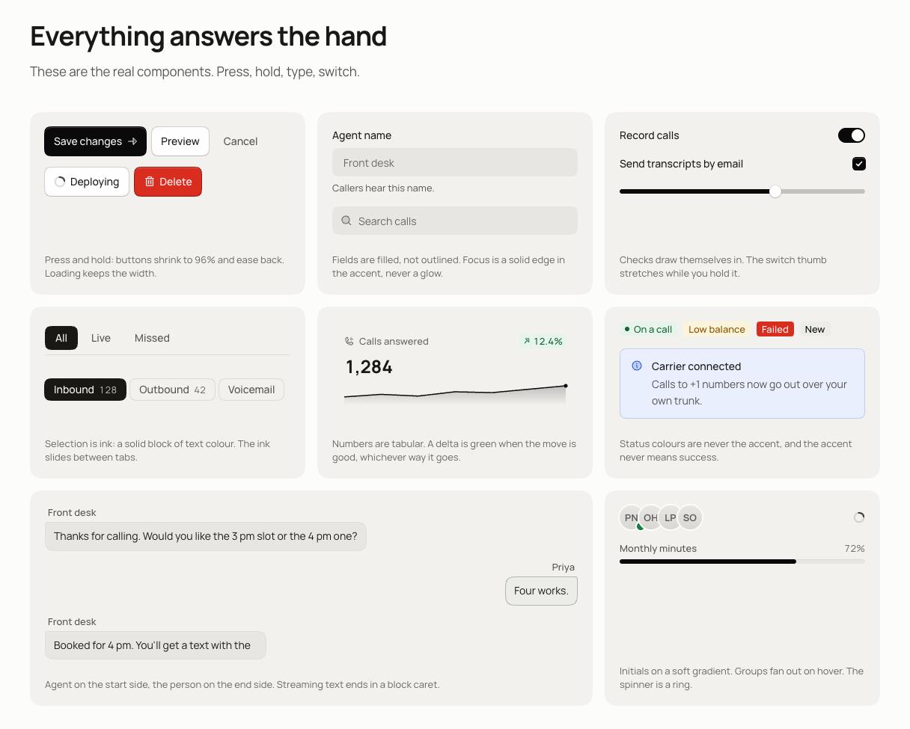

# wixzel_ui

Wixzel UI for Flutter: a `ThemeData` that keeps stock Material from showing
through, `Wx*` widgets with squircle corners, press-to-shrink and blur-in
entrances, and a whole palette from one seed colour, identical to the web's.

[](https://ui.wixzel.com/components/)

The web components are shown above; the `Wx*` widgets follow the same tokens and
the same details.

```dart
import 'package:wixzel_ui/wixzel_ui.dart';

final brand = wxDeriveProduct(const Color(0xFFE4572E));

MaterialApp(
  theme: WixzelTheme.custom(tokens: brand).toThemeData(),
  darkTheme: WixzelTheme.custom(tokens: brand, brightness: Brightness.dark).toThemeData(),
  home: Scaffold(
    body: Center(child: WxButton(label: 'Save changes', variant: WxButtonVariant.primary, onPressed: () {})),
  ),
);
```

Docs: https://ui.wixzel.com/docs/flutter/ · MIT
