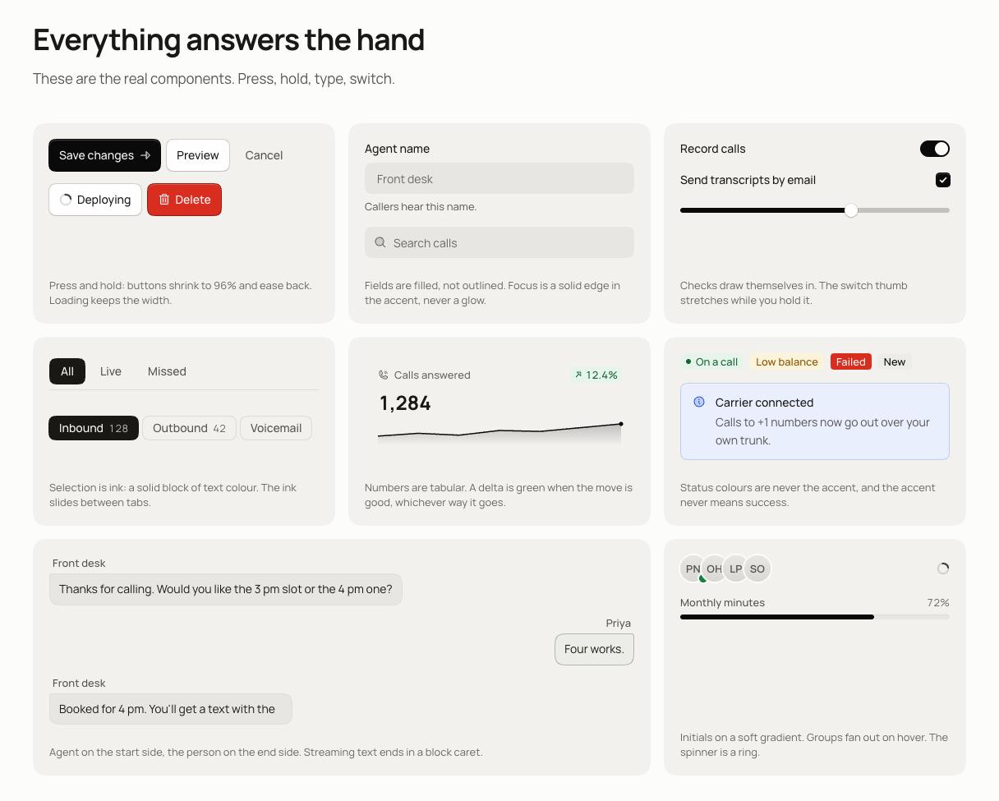

# wixzel-ui

Wixzel UI components for React 19 and Tailwind CSS v4: calm, tonal, crafted, and
one seed colour away from your brand.

[](https://ui.wixzel.com/components/)

```bash
npm i wixzel-ui
npx wixzel-ui --seed "#E4572E" > src/brand.css
```

```css
@import "tailwindcss";
@import "wixzel-ui/styles.css";
@import "./brand.css";
```

```tsx
import { Button, WixzelProvider } from "wixzel-ui";

<WixzelProvider>
  <Button variant="primary">Save changes</Button>
</WixzelProvider>
```

Every component, live: https://ui.wixzel.com/components/ · Docs: https://ui.wixzel.com/docs/react/ · MIT
